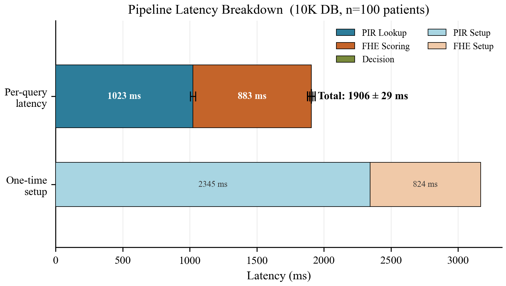
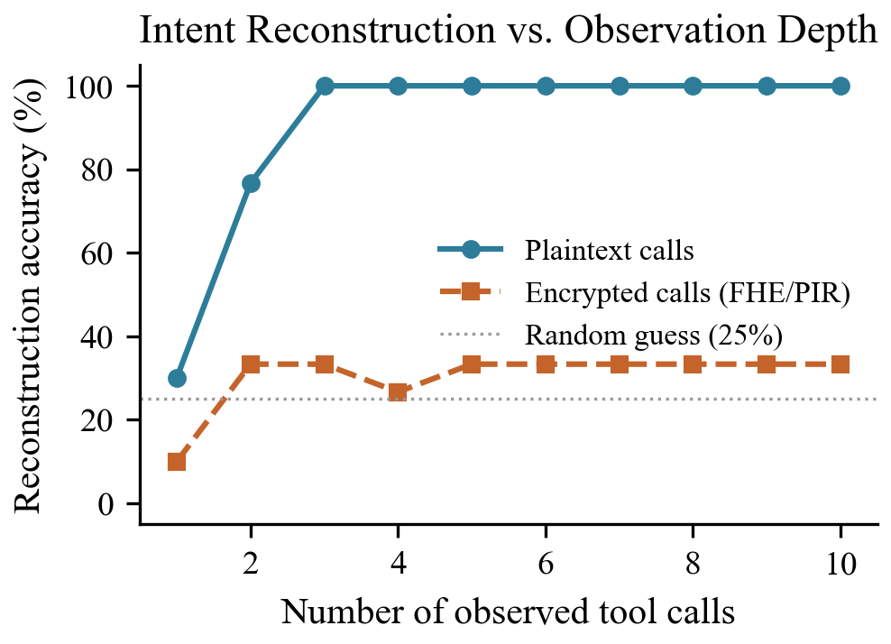
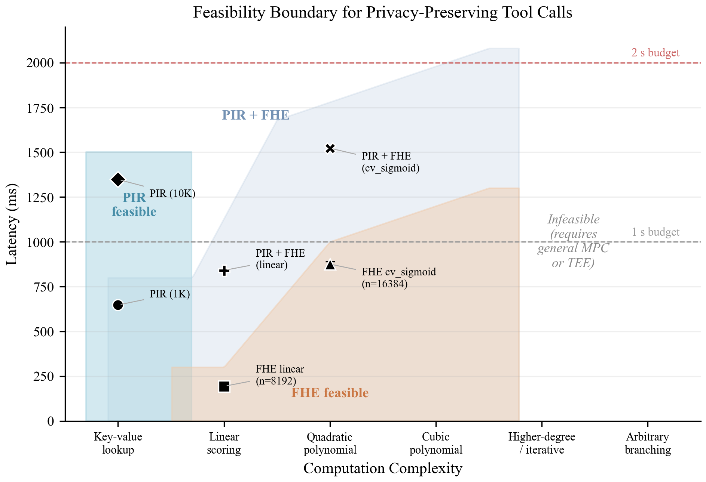

<div align="center">

# 🔐 Can FHE Protect AI Agents?

**A threat model and feasibility study of encrypted tool-calling for AI agents**


</div>

---

When an AI agent calls an external tool, the tool server sees the request in plaintext. A medical agent that checks *"does warfarin interact with ibuprofen?"* has just told the drug-database server what the patient takes.

This project asks a simple question: **can we hide tool-call content from the server using cryptography, and what does it cost?**

It contains:

1. **A threat model** for an *honest-but-curious* tool server, with three leakage channels (direct content, cross-call correlation, frequency) and three intent-reconstruction attacks that exploit them.
2. **A mapping from tool-call types to cryptographic primitives**: PIR for lookups, FHE for bounded computation, ORAM for access patterns, and nothing practical for arbitrary execution.
3. **A working prototype**: a healthcare pipeline that chains a **PIR drug-interaction lookup (BFV)** with an **FHE risk score (CKKS)**. Each server only ever receives ciphertext.

> All data is **synthetic** (seeded, reproducible). Nothing here should be used for real clinical decisions.

---

## ✨ Results at a glance

Measured on an AMD Ryzen AI 9 365 (10C/20T), 32 GB RAM, Windows 11, Python 3.12.4, TenSEAL 0.3.16.
Raw numbers are in [`results/benchmarks/`](results/benchmarks/).

| What | Result | Source |
|---|---|---|
| End-to-end pipeline (PIR lookup + FHE score, 10K-record DB) | **1,906 ± 29 ms** per patient | `pipeline_benchmarks_scaled.json` |
| ↳ PIR lookup phase | 1,023 ± 20 ms | 〃 |
| ↳ FHE scoring phase (CKKS, n = 16384, depth 4) | 883 ± 12 ms | 〃 |
| Correctness over 100 patients | PIR **100/100**, FHE **100/100** | 〃 |
| CKKS numerical error (dot product + cubic sigmoid) | max ≈ 1.3 × 10⁻⁶ | `fhe_benchmarks_scaled.json` |
| Linear-only FHE score (n = 8192, depth 2) | 193 ± 3 ms | 〃 |
| Peak memory (full pipeline) | ≈ 1.4 GB RSS | `pipeline_benchmarks_scaled.json` |
| Galois keys, n = 8192 → 16384 | 32 MB → 164 MB (5.1×) | `galois_key_analysis.json` |
| Intent-reconstruction accuracy (4 intents, best attack) | **100 % → 33 %** (random guessing = 25 %) | `leakage_analysis/reconstruction_results.json` |

<p align="center">
  
</p>

<p align="center">
  
  
</p>

### How to read these numbers

- **"Zero content leakage" holds by construction.** The PIR and FHE servers only receive BFV/CKKS ciphertexts and never hold a secret key. Their logs (`query_log`, `lookup_log`, `scoring_log`) record only sizes and timings. This follows from the semantic security of the schemes; it is not an information-theoretic measurement. **Metadata (timing, ciphertext size, number of calls) is still visible.**
- **About 93 % of the FHE time is not cryptography.** `FHEContext.decrypt_vector()` re-deserializes the full TenSEAL context on every call, which takes ≈ 870 ms. The CKKS decryption itself takes ≈ 3 ms. An agent that keeps its context in memory would score a patient in roughly 50 ms. The table reports the code as written.
- **The PIR is a baseline, not an optimized scheme.** It sends an *n*-slot one-hot query and gets back one ciphertext per 2-byte chunk of the record, about **56 MB per query** (≈ 112 MB at 10K records, which needs two ciphertexts). At these database sizes, simply downloading the whole database ("trivial PIR", 25 KB–2.5 MB) uses far less bandwidth. Production systems would use SealPIR/FastPIR/SimplePIR-style query compression.
- **The intent-reconstruction drop is simulated.** "Encrypted" sessions are produced by `make_encrypted_session()`, which hides tool/method names and parameters and pads sizes to 512 bytes, but **keeps timing, call count and call type**. Under these assumptions all three attacks fall to roughly random guessing (23–33 % on a 30-session test set with 4 intents).

---

## 🧠 How it works

```
          Agent (holds secret keys)                         Tool servers (public context only)
 ┌──────────────────────────────────────┐          ┌──────────────────────────────────────────┐
 │ 1. map (drug_a, drug_b) → index i     │          │                                          │
 │    encrypt one-hot vector e_i  (BFV) ─┼────────► │ Drug DB:  e_i ⊙ column_k  for every chunk │
 │                                      ◄┼──────────┼─ encrypted record chunks                  │
 │    decrypt, sum slots → record        │          │                                          │
 │                                       │          │                                          │
 │ 2. normalize 8 patient features       │          │                                          │
 │    encrypt x  (CKKS)                 ─┼────────► │ Risk model:  σ̃(w · x + b)                │
 │                                      ◄┼──────────┼─ encrypted score  (σ̃ = cubic sigmoid)     │
 │    decrypt → risk score               │          │                                          │
 │                                       │          │                                          │
 │ 3. decide locally (plaintext)         │          │  sees: ciphertext sizes + timing only     │
 └──────────────────────────────────────┘          └──────────────────────────────────────────┘
```

**Cryptographic parameters** (128-bit security per the HE standard tables):

| Component | Scheme | Ring dim. *n* | Modulus chain | Mult. depth |
|---|---|---|---|---|
| PIR lookup | BFV | 8192 | SEAL default, plain modulus 1,032,193 | 1 (ct × pt) |
| FHE "light" preset | CKKS | 8192 | [60, 40, 40, 60], scale 2⁴⁰ | 2 |
| FHE "deep" preset (used by the pipeline) | CKKS | 16384 | [60, 40, 40, 40, 40, 60], scale 2⁴⁰ | 4 |

The depth-2 preset **cannot** run the full dot-product + cubic-sigmoid model; see `results/systems_friction_report.txt`.

---

## 🚀 Quick start

```bash
git clone https://github.com/KhattabHimself/fhe-agent-privacy.git
cd fhe-agent-privacy

make venv     # create ./venv, install requirements, pip install -e .
make check    # verify every dependency imports
make data     # generate the synthetic datasets (seeded, ~seconds)
make test     # 119 tests
make demo     # end-to-end encrypted healthcare demo
```

<details>
<summary><b>No <code>make</code>? (e.g. plain Windows PowerShell)</b></summary>

```bash
python -m venv venv
# Windows: venv\Scripts\activate    Linux/macOS: source venv/bin/activate
pip install -r requirements.txt
pip install -e .                    # makes `src` importable from the scripts

python data/generate_all.py
python -m pytest tests/
python experiments/run_prototype_demo.py --quick
```
</details>

**Requirements:** Python 3.10+, ~2 GB free RAM. No GPU needed. On Windows, use Git Bash or WSL for `make`.

> **TenSEAL install trouble?** Pre-built wheels exist for most platforms. If `pip install tenseal` fails, see the build instructions at [OpenMined/TenSEAL](https://github.com/OpenMined/TenSEAL).

### Interactive walkthrough

```bash
pip install jupyter
jupyter notebook demo.ipynb
```

The notebook steps through the plaintext leakage problem, a PIR lookup, FHE scoring, the full encrypted pipeline and the feasibility analysis.

---

## 🔬 Reproducing the results

| Command | Runs | Writes |
|---|---|---|
| `make data` | `data/generate_all.py` | `data/*.json` |
| `make benchmarks-pir` | `run_benchmarks.py --pir-only` | `results/benchmarks/pir_benchmarks_scaled.json` |
| `make benchmarks-fhe` | `run_benchmarks.py --fhe-only` | `results/benchmarks/fhe_benchmarks_scaled.json` |
| `make benchmarks-pipeline` | `run_benchmarks.py` | `results/benchmarks/pipeline_benchmarks_scaled.json` |
| `make benchmarks-memory` | `run_memory_benchmarks.py` | `results/benchmarks/memory_benchmarks.json` |
| `make benchmarks-systems` | `run_systems_analysis.py` | `results/systems_friction_report.txt` + precision / noise / Galois JSON |
| `make leakage` | `run_leakage_analysis.py` | `results/leakage_analysis/*.json` |
| `make figures` | `visualize_feasibility.py`, `visualize_threat_model.py`, `visualize_precision.py` | `results/figures/*.{png,pdf}` |
| `make demo` | `run_prototype_demo.py` | `results/demo_output.txt`, `results/demo_timings.json` |
| `make all` | everything above | ≈ 30–60 min |
| `make quick` | toy data + `--small` benchmarks + feasibility figures | a few minutes |

There is also a single-script runner that prints a summary table and writes a timestamped log:

```bash
python experiments/reproduce_all.py --quick    # or --full (default)
```

Timings depend on hardware. Correctness counts, CKKS error and attack accuracies should reproduce exactly from the fixed seeds.

---

## 🗂️ Repository layout

```
fhe-agent-privacy/
├── src/
│   ├── threat_model/
│   │   ├── definitions.py            ToolCallType, AdversaryModel, PrivacyProperty, ToolCall, ThreatModel
│   │   ├── leakage_analysis.py       direct / correlation / frequency leakage metrics
│   │   └── intent_reconstruction.py  Frequency, Sequence (bigram) and Random-Forest attacks
│   ├── feasibility/
│   │   ├── pir_lookup.py             BFV computational PIR (PIRClient / PIRServer) + trivial PIR
│   │   ├── fhe_computation.py        CKKS context, encrypted linear & polynomial models
│   │   ├── benchmarks.py             timing / memory measurement helpers
│   │   ├── systems_analysis.py       precision, noise budget, Galois key and RAM analysis
│   │   └── oram_access.py            Path ORAM interface (stub, see below)
│   ├── prototype/
│   │   ├── encrypted_lookup.py       PIR drug-interaction lookup   ← used by the pipeline
│   │   ├── encrypted_scoring.py      CKKS cardiovascular risk score ← used by the pipeline
│   │   ├── agent.py                  agent/tool-server interfaces (stub, see below)
│   │   └── tool_server.py            〃
│   └── utils/                        data generation/loading, AES-GCM + serialization helpers
├── experiments/                      benchmark, leakage, demo and plotting scripts
├── tests/                            pytest suite (PIR, FHE, threat model): 119 tests
├── data/                             generate_all.py + schema docs (JSON is generated, not committed)
├── results/                          committed benchmark outputs and figures
├── demo.ipynb                        interactive walkthrough
├── Makefile · requirements.txt · setup.py · setup_check.py
└── LICENSE
```

---

## ⚠️ Scope and limitations

This is a research prototype, written to measure feasibility. It is not production code.

- **Single-process simulation.** Agent and servers run in one Python process with no network. Communication cost is computed from serialized ciphertext sizes. In the FHE scorer, the "server" step operates on ciphertexts linked to the agent's context object instead of a separately deserialized public context. The PIR path does use a separate public context for the server.
- **Unimplemented interfaces.** `src/feasibility/oram_access.py` (Path ORAM), `src/prototype/agent.py` and `src/prototype/tool_server.py` define the APIs but raise `NotImplementedError`. ORAM is covered analytically, not executed. The working pipeline is `EncryptedDrugLookup` + `EncryptedScoringTool`, driven by `experiments/run_prototype_demo.py` and `run_benchmarks.py`.
- **Honest-but-curious only.** Malicious servers (wrong results, replay) would require verifiable computation, which is out of scope.
- **Metadata is not hidden.** Timing, ciphertext sizes and call counts remain observable. Padding and dummy queries are discussed but not implemented.
- **Synthetic workload.** Drug names come from real prefixes and suffixes but the interactions are generated, and the risk model's weights are hand-picked for demonstration.
- **`leakage_bits` in `leakage_report.json`** is the intent-entropy reduction H(before) − H(after). The report is generated without ground-truth user attributes, so this field is 0 by definition there. Use the attack accuracies as the measure of intent leakage.

---

## 📚 Background

- C. Gentry, *Fully Homomorphic Encryption Using Ideal Lattices*, STOC 2009
- Z. Brakerski, *Fully Homomorphic Encryption without Modulus Switching from Classical GapSVP*, CRYPTO 2012 · J. Fan & F. Vercauteren, *Somewhat Practical FHE*, 2012 (BFV)
- J. H. Cheon, A. Kim, M. Kim, Y. Song, *Homomorphic Encryption for Arithmetic of Approximate Numbers*, ASIACRYPT 2017 (CKKS)
- B. Chor, O. Goldreich, E. Kushilevitz, M. Sudan, *Private Information Retrieval*, FOCS 1995 · S. Angel et al., *PIR with Compressed Queries and Amortized Query Processing*, IEEE S&P 2018 (SealPIR)
- E. Stefanov et al., *Path ORAM*, CCS 2013
- S. Yao et al., *ReAct*, ICLR 2023 · T. Schick et al., *Toolformer*, NeurIPS 2023
- K. Greshake et al., *Not What You've Signed Up For: Compromising Real-World LLM-Integrated Applications with Indirect Prompt Injection*, AISec 2023
- [TenSEAL](https://github.com/OpenMined/TenSEAL) · [Microsoft SEAL](https://github.com/microsoft/SEAL)

---

## 📝 Citation

```bibtex
@misc{fhe-agent-privacy-2026,
  title  = {Can {FHE} Protect {AI} Agents? A Threat Model and Feasibility
            Study of Encrypted Tool-Calling},
  author = {Mohamed},
  year   = {2026},
  note   = {Course project, Security, Spring 2026},
  howpublished = {\url{https://github.com/KhattabHimself/fhe-agent-privacy}}
}
```

## License

MIT. See [LICENSE](LICENSE).
